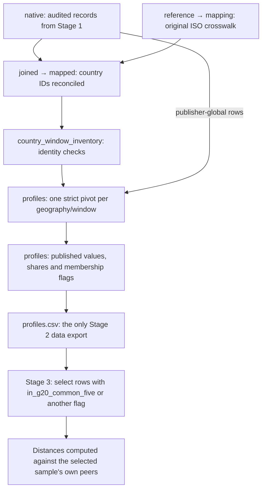

# One curated profile table

[02_build_profiles.py](02_build_profiles.py) writes one table:
[profiles.csv](../results/02_build_profiles/profiles.csv).
Each row is an **observed country/window or publisher-global/window**. The current
sources produce 709 rows: 704 country/windows and five global aggregates.

Published percentages, conditional shares, coverage, source lineage and sample
membership are columns of this table. There are no separate core/G20 datasets,
membership tables, mode-share exports or denominator tables.



Country IDs are matched to the original `INPUT_CROSSWALK` under the same
`INPUT_SOURCE_LOCK` used during loading. `country_window_inventory` detects
multiple native IDs mapping to one country/window. These temporary variables
support checks; they are not exported as additional tables. `NONE` source rows
remain in Stage 1's native records and are explained in the log.

`profiles` is constructed from `combined` using a strict pivot. Five-mode
percentages are divided by `classified_total_pct`. Missing modes and missing
histories never become zero observations. `partition_eligible` records usable
five-mode publication; partial profiles remain in the same table with missing
conditional shares. The declared number of source windows determines whether a
history is complete—absent country/windows need no manufactured rows.

| Column | Meaning |
| --- | --- |
| `in_legacy_stable` | Complete publication in every legacy window; selects legacy rows |
| `in_monthly_stable` | Complete publication in every monthly window; selects monthly rows |
| `in_common_five` | Complete publication in all five windows |
| `in_full_published` | Eligible publication in this window |
| `is_g20_country` | The country belongs to the fixed 19-country G20 roster |
| `in_g20_common_five` | `is_g20_country` and `in_common_five` |
| `geo_level` | Separates country observations from publisher-global context |
| `source_run_id` | The audited source execution producing these values |

For example, in a stage that has read `profiles`:

```python
g20 = profiles.loc[profiles["in_g20_common_five"]]
```

This is a temporary subset used for analysis. G20 distances must still be
computed against G20 peers; a wider-population distance cannot be filtered into
a G20 distance.

Run `make practices-profiles` from the root to rebuild Stages 1–2. Audit findings,
quarantine details, unavailable roster countries and sample counts are recorded
in `logs/practices.log` and the Stage 2 entry of `logs/run.json`. The original
source and ISO fingerprints remain checked; intermediate files are not hashed.
The curated profile table is CSV-only.
CSV uses `<NA>` for missing values, preserving empty strings and Namibia's `NA`.

The five conditional shares describe the classified modes. Denominator and
none/unclassified coverage columns preserve the context needed to interpret
normalization. Stable countries do not guarantee stable users or measurement.
