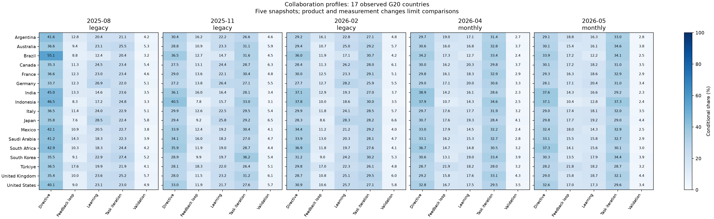
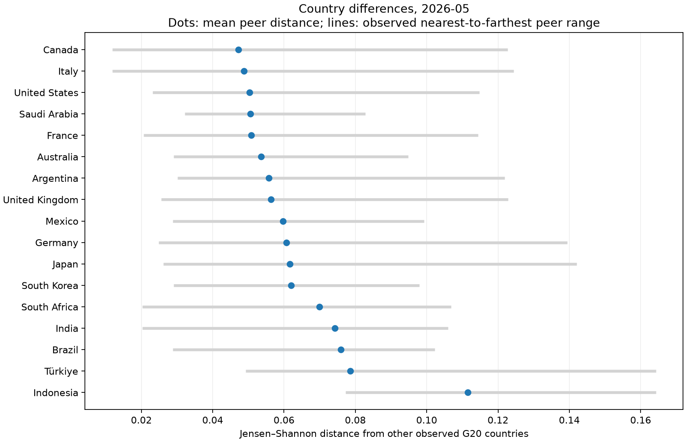
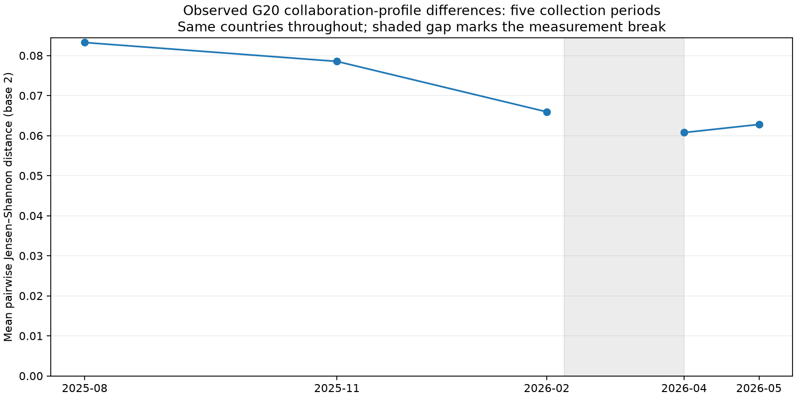
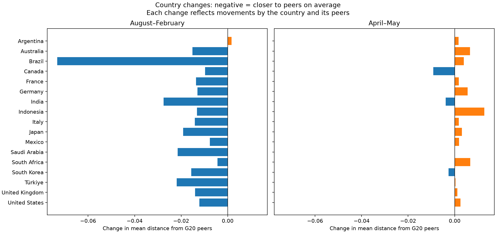
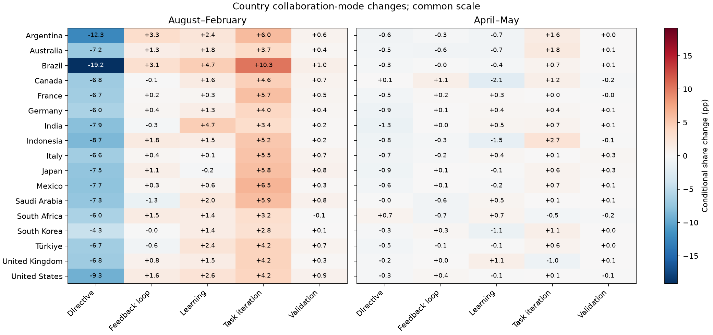
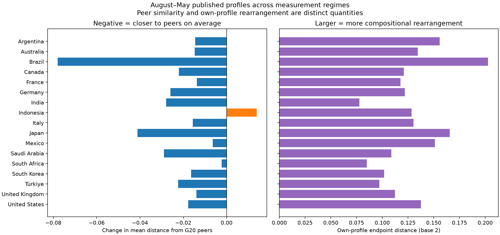
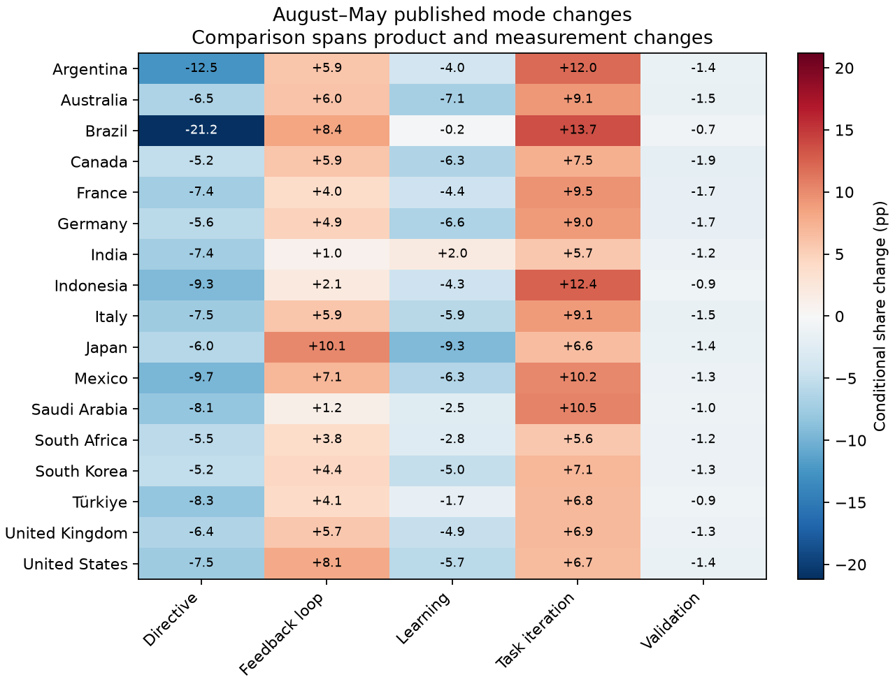
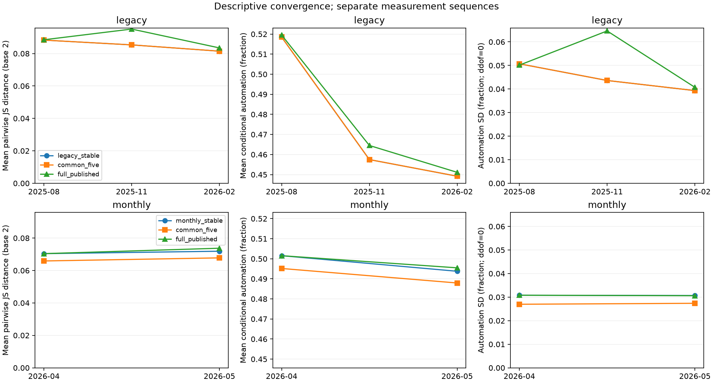
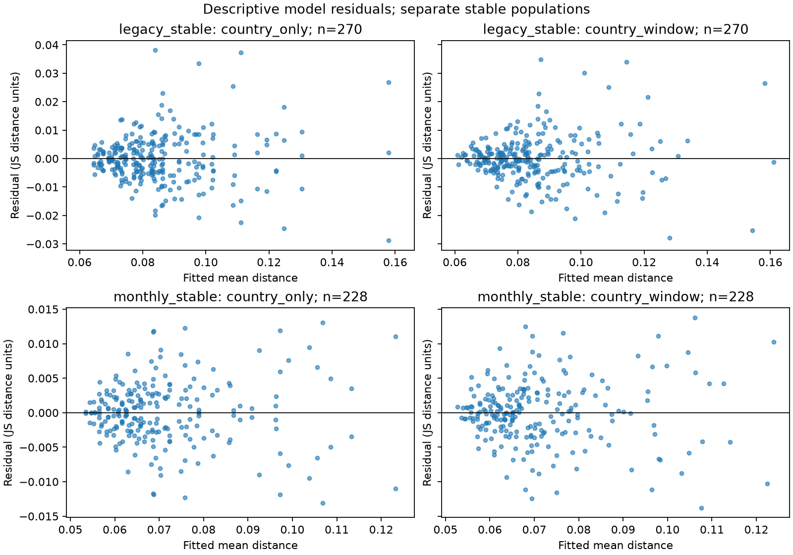
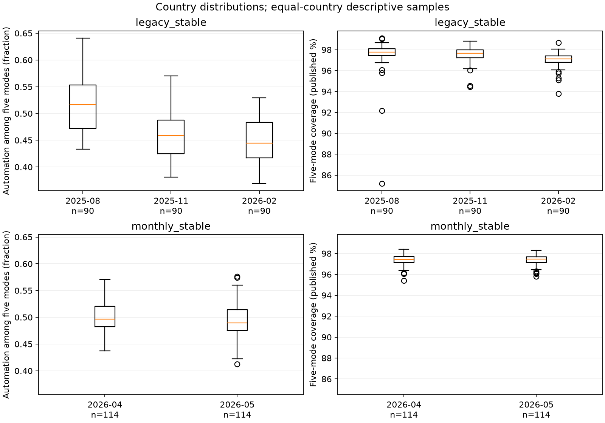

# Convergence and differentiation in AI-use practices

*An exploratory descriptive study of Anthropic Economic Index data,
covering five collection periods from August 2025 to May 2026.*

A request to an AI system can delegate work, seek an explanation, or begin a
process of revision. These activities organize the relationship between a
person and a model in different ways. Their relative prevalence gives AI use
an observable composition: a pattern of delegation, learning, and collaboration.

Do these patterns become more similar across countries over time? This study
examines country-level collaboration measures in the Economic Index dataset
published by Anthropic. It combines a broad comparison of eligible countries
with a closer examination of seventeen observed G20 members.

Institutional isomorphism provides a social motivation for the question: shared
technologies may be accompanied by increasingly similar practices. The empirical
task is to measure that similarity and its persistence. Country aggregates can
describe convergence, but cannot distinguish imitation, professional norms,
coercive pressures, or changes in the people using the system.

## Executive summary

Among the **17 observed G20 countries**, Claude collaboration profiles become
more similar between August 2025 and February 2026: mean pairwise distance
falls **20.79%**. April–May 2026 shows renewed differentiation, with distance
rising **3.34%**. Both endpoint directions survive every single-country and
single-mode exclusion checked. These are separate measurement sequences;
no February–April behavioral change is estimated.

A secondary August–May comparison adds a longer perspective: published profile
dispersion is **24.58% lower** in May, despite the April–May increase. This decline
also survives every single-country and single-mode exclusion. Sixteen countries
are closer to peers; Indonesia moves farther away. The comparison spans changes
in products, classification, and collection length, so the full decline cannot
be attributed to convergence in underlying practices under constant measurement.

Country comparisons show what the aggregate changes contain:

- **Common movement does not erase differences.** Brazil has the largest
  August–February decline in distance from peers, accompanied by less
  directive use and more task iteration and learning. Argentina alone moves slightly farther
  from peers, even though its automation share also falls. Automation country
  ranks remain persistent: Spearman correlations are **0.909** over the legacy
  endpoint and **0.980** over April–May.
- **Similar automation can conceal different practices.** In May, Japan and
  Indonesia differ by only **0.06 percentage points** in automation, yet their
  five-mode distance is **0.142041**, compared with **0.026189** for Canada–Japan.
  Indonesia combines more directive use and task iteration with less feedback
  and learning. Canada–Italy is the closest May pair; Indonesia has the largest
  mean distance from the other observed G20 countries.
- **Convergence is uneven over time and across populations.** The small
  August–November decline reverses when Brazil, directive use, or learning is
  excluded. The full August–February G20 endpoint survives those exclusions.
  In the broader 90-country comparison, the **7.73%** August–February decline
  reverses when learning is omitted. Its 114-country April–May increase is
  **2.12%**. These different populations answer different descriptive questions.
- **Automation and profile similarity are distinct.** G20 conditional automation
  averages fall from **50.90% to 43.62%** over the legacy endpoint, with dispersion
  narrowing from **5.43 to 3.84 pp**. April–May profile differentiation increases
  while automation dispersion narrows slightly, from **2.52 to 2.44 pp**.

For each country, five published modes—directive, feedback loop, learning,
task iteration, and validation—are expressed as fractions of their combined
total. Average base-2 Jensen–Shannon distance compares the full compositions;
lower distance means greater similarity. Countries and distinct pairs receive
equal weight. The outcome measures patterns of recorded use, not its volume.

These exploratory aggregates support a description of convergence alongside
persistent differences. They cannot identify imitation, professional norms,
coercive pressures, individual transitions, or economy-wide adoption. Changes
in products, classifiers, users, publication, and collection windows remain
measurement limits. No statistical significance or sampling uncertainty is
claimed. The distinction between observed convergence and its social explanation
is central to the interpretation: similar distributions do not establish that
the same process produced them.

## Econometric method in brief

- **Define a descriptive estimand.** Measure the average difference between
  countries' collaboration profiles in each collection period, then compare
  those averages over time. The unit of analysis is a country–period aggregate;
  the objective is description, without identifying a causal adoption effect.
- **Audit the published observations.** Select overall country and global
  collaboration measures from Anthropic's Economic Index files. Reconcile
  schemas, dates, labels, identifiers, duplicate records, and percentage totals.
  Preserve source values, denominator coverage, and record provenance.
- **Construct balanced country samples.** Require five explicitly published,
  unique, finite mode percentages within valid ranges and a positive total.
  Retain the same 90 countries across August, November, and February, 114 across
  April–May, and 17 observed G20 countries across all five periods. Assess
  common-country and changing-coverage alternatives separately.
- **Construct the variables.** Divide each of the five published mode
  percentages by their combined total. Keep the original percentages and
  coverage alongside these conditional fractions. Define automation as
  directive use plus feedback loops. Preserve published zeros; do not convert
  missing modes into zeros or average duplicate observations.
- **Estimate cross-country similarity.** Calculate base-2 Jensen–Shannon
  distance with SciPy for every distinct unordered country pair, excluding
  self-comparisons. Average pairs equally. Also calculate each country's mean
  distance from its peers; lower distance denotes greater compositional
  similarity, without weighting countries by conversation volume.
- **Compare periods and complementary outcomes.** Use February minus August
  as the primary endpoint, report both intervening changes, and evaluate May
  minus April separately. Examine automation means and population standard
  deviations, mode dispersion, and Spearman rank persistence. Add August–May
  as a secondary comparison of published profiles across measurement regimes,
  with its own country/mode sensitivities and each country's endpoint profile
  distance. Product and classifier changes prevent identifying behavioral change
  under constant measurement; no February–April contrast is estimated.
- **Use regression as a descriptive decomposition.** For the broader balanced
  samples, fit ordinary least squares with country intercepts and categorical
  period effects, against a country-intercept-only baseline. Examine residual
  fit and influence. Period contrasts reproduce the aggregate distance changes;
  they provide no independent confirmation. No additional G20 regression is
  needed for the same decomposition.
- **Assess sensitivity and the limits of inference.** Repeat comparisons after
  excluding each country and after omitting and renormalizing each mode; audit
  alternative populations and automation denominators. Retain reversals and
  unavailable cases. Shared countries make pair distances dependent, and the
  published aggregates do not justify conversation-level uncertainty estimates.
  Report descriptive estimates without default p-values or confidence intervals.
- **Verify reproducibility and disclose exploration.** Preserve the chain from
  source observations to tables and figures through linear scripts, file hashes,
  reconciliation checks, synthetic integration tests, and repeated execution.
  The G20 focus and country illustrations followed inspection of earlier
  results. The August–May extension also followed exposure to the five window
  estimates and a proposed endpoint comparison. The study remains exploratory;
  those choices are documented rather than presented as preregistered hypotheses.

The [data and variable definitions](#from-published-data-to-the-analytical-outcome)
below specify the source filters, eligibility rules, denominators, and distance
formula. The [broader country comparisons](#broader-country-comparisons) establish
how the G20 findings depend on population scope.

## G20 countries: delegation, learning, and collaboration

An average distance compresses many relationships into one quantity. Examining
named countries makes it possible to see which combinations of practices lie
behind that quantity, which differences persist, and where countries move
against the aggregate direction.

### Seventeen observed countries across five periods

The G20 country frame contains nineteen members. China and Russia are absent
from the available country coverage; absence is not evidence of no AI use.
The EU and AU are regional members, rather than country observations. The sample
contains the same **17 countries in all five collection windows**, giving
**85 profiles and 425 mode cells**. Profile counts reconcile with sample
membership. Original percentages and five-mode denominator coverage are retained.

The [country summary](data_audit/g20_country_summary.csv) and
[coverage grid](data_audit/g20_membership_coverage.csv) record the full frame.
The [country profile table](data_audit/g20_country_profiles.csv) retains both
original percentages and conditional shares. Each country–period profile enters
once, drawn from the full eligible country data before restricting membership
to the G20 sample. Profiles repeated across alternative analytical samples are
not pooled. No reclassification, imputation, or second normalization is applied.



The figure shows conditional percentages among the five named modes, with a
fixed country order and common scale across snapshots. All 17 countries remain
visible. April and May use a different measurement regime from the first three
windows; the panels do not establish an uninterrupted behavioral trend.
The [country trajectory companion](assets/g20_country_trajectories.pdf)
shows all seventeen countries over the five collection periods, with the
measurement break marked; a [PNG copy](assets/g20_country_trajectories.png)
is also available.

### Similar automation shares can conceal different practices

In May, Canada, Japan, and Indonesia have almost identical conditional automation
shares, but their underlying collaboration profiles differ:

| Country | Automation | Directive | Feedback loop | Learning | Task iteration | Validation |
| --- | ---: | ---: | ---: | ---: | ---: | ---: |
| Canada | 47.33% | 30.09% | 17.24% | 18.20% | 30.97% | 3.50% |
| Japan | 47.45% | 29.77% | 17.67% | 19.18% | 29.01% | 4.36% |
| Indonesia | 47.51% | 37.13% | 10.38% | 12.83% | 37.25% | 2.41% |

All values are conditional percentages; displayed components can differ from
totals through rounding. Indonesia combines a larger directive share with a
smaller feedback-loop share, and more task iteration with less learning.
An automation-only comparison would obscure both distinctions. These three
countries are illustrations selected after viewing all 17 profiles; they are
not prespecified cases. The pairwise comparison quantifies differences across
the full composition.

### A changing mix between August and February

Brazil provides another illustration. Its directive share is **55.11% in August
and 35.95% in February**, while task iteration is **20.44% and 30.71%**, and
learning **12.42% and 17.15%**. Its conditional automation share is **63.95%
and 47.90%**, respectively. The published mix shifts away from directive use
and toward other practices within this comparison.

These country snapshots describe aggregate compositions, not transitions by
fixed individuals. Product coverage, user composition, and classification
changes can contribute. They neither establish national cultures nor explain
the social mechanisms behind a country difference.

### What the full profiles reveal about country peers

The pairwise comparison covers **136 distinct country pairs per window**,
with equal weights and the same 17 countries throughout. It produces **680
pair/window records** and **85 country mean distances**, each against 16 peers.
The country and pair means reconcile with the aggregate distance measure.

In May, **Canada–Italy** is the closest pair, with distance **0.011809**;
**India–South Africa** follows at **0.020235**. **Indonesia–Türkiye** is the
farthest pair at **0.164283**. Canada's average distance from its peers is
**0.047225**, while Indonesia's is **0.111573**, the largest in this population.
Indonesia's closest peer is South Africa, at **0.077252**. These comparisons
locate distinctive compositions within the observed group; they do not
establish cultural explanations, quality, or intensity of adoption.



The points show mean distance from the other 16 countries. The lines show the
observed range from the nearest to the farthest peer; they are not confidence
intervals. Country positions depend on the comparison population. The
[five-window pair matrix](assets/g20_pairwise_distances.png) retains every
observed pair in a fixed alphabetical order and uses a common color scale.

For Canada, Japan, and Indonesia, the May comparisons are:

| May pair | Conditional automation gap (pp) | Five-mode JS distance |
| --- | ---: | ---: |
| Canada–Japan | 0.119440 | 0.026189 |
| Canada–Indonesia | 0.179271 | 0.122720 |
| Japan–Indonesia | 0.059830 | 0.142041 |

Japan and Indonesia are the closest of these three pairs in automation alone,
yet the farthest in the full profile. Indonesia's balance between directive
use and feedback loops, and between task iteration and learning, distinguishes
it even when the two automation modes have almost the same combined share.
The distance reflects the whole composition; it does not attribute a causal
contribution to any one mode.

The descriptive viewing rule retains **all 90 pair/window records** with an
automation gap no greater than one percentage point. It was chosen after
profile exposure and before pairwise inspection. It is not a causal matching
design. The [complete viewing export](data_audit/g20_automation_matched_pairs.csv),
[nearest peers](data_audit/g20_nearest_peers.csv),
[country summaries](data_audit/g20_country_distances.csv), and
[all pair distances](data_audit/g20_pairwise_distances.csv) preserve comparisons
beyond the illustrations above.

### Five snapshots and the main temporal comparisons

The [window summary](data_audit/g20_window_summary.csv) gives these
levels for the same 17 countries and 136 pairs in every window:

| Collection period | Comparison sequence | Mean pairwise JS distance |
| --- | --- | ---: |
| August 2025 | Legacy | 0.083260 |
| November 2025 | Legacy | 0.078547 |
| February 2026 | Legacy | 0.065948 |
| April 2026 | Monthly | 0.060771 |
| May 2026 | Monthly | 0.062798 |



The figure keeps all five periods on one time axis, with actual date spacing.
The gap separates measurement sequences. Lower distance means greater similarity;
no February–April contrast or continuous behavioral trend is estimated.
The [temporal contrasts](data_audit/g20_contrasts.csv) distinguish the primary
endpoint from adjacent changes:

| Contrast | Role | Absolute distance change | Relative change |
| --- | --- | ---: | ---: |
| August–February | Primary endpoint | -0.017312 | -20.79% |
| August–November | Legacy adjacent | -0.004713 | -5.66% |
| November–February | Legacy adjacent | -0.012599 | -16.04% |
| April–May | Secondary comparison | +0.002027 | +3.34% |

### Shared movement with country exceptions

Sixteen of the seventeen countries have a lower mean distance to peers in
February than in August. Brazil has the largest decline, from **0.153971 to
0.080726**. Its mode changes, described above, include **19.16 pp less directive
use**, **10.27 pp more task iteration**, and **4.72 pp more learning**.
Argentina alone has a higher mean peer distance, increasing **0.001692**, while
its automation share falls **9.04 pp**. Every country has lower automation over
this endpoint, on both conditional and original-denominator scales; a common
shift in levels does not ensure that each country becomes closer to its peers.

April–May has a different balance: fourteen countries move farther from peers
on average. **Canada, India, and South Korea** move closer. Canada's decline is
largest (**-0.009143**), while Indonesia's increase is largest (**+0.012788**).
Indonesia's task-iteration share rises **2.69 pp**, while learning falls
**1.51 pp**. These accompanying changes describe its mix; they do not causally
explain its distance movement. Country distance changes reflect movements by
the country and its peers together.



The panels use the same distance-change scale. All countries remain visible,
including those moving against the aggregate direction. The
[full country-change table](data_audit/g20_country_changes.csv) retains original
percentages, conditional shares, coverage, and all four contrasts. Illustrative
extremes were selected after inspecting the complete results.



The annotated panels use a common percentage-point scale, making the smaller
monthly changes visible numerically. They describe aggregate profiles, not
transitions by fixed individuals. Among the 136 pairs, **110 become closer and
26 farther** over August–February; **84 become farther and 52 closer** over
April–May. The [pair-change table](data_audit/g20_pair_changes.csv) retains every
pair. Shared countries make these pairs dependent; the counts are descriptive.

### Convergence with persistent relative differences

Automation country ranks are persistent: Spearman correlations are **0.909**
over August–February and **0.980** over April–May. Pair-distance rank correlations
are **0.815** and **0.939**, respectively. Countries can become closer while
much of their relative ordering remains. Pair-distance persistence describes
which pairs are relatively close; it is distinct from country automation ranks.
The [rank summaries](data_audit/g20_rank_persistence.csv) retain adjacent results
and contain no p-values or uncertainty intervals.

Automation summaries separate common movement from cross-country dispersion:

| Period | Conditional mean | Conditional SD (pp) | Original-denominator mean | Original-denominator SD (pp) |
| --- | ---: | ---: | ---: | ---: |
| August | 50.90% | 5.43 | 49.65% | 5.40 |
| February | 43.62% | 3.84 | 42.31% | 3.78 |
| April | 48.39% | 2.52 | 47.17% | 2.42 |
| May | 47.91% | 2.44 | 46.72% | 2.36 |

These are equal-country means and population standard deviations (`ddof=0`),
not global conversation-weighted statistics. Both scales show lower automation
and narrower dispersion over the legacy endpoint. April–May profile distance
increases while automation dispersion narrows slightly. The full composition
therefore adds information beyond the sum of directive use and feedback loops.
[Mode-specific dispersion](data_audit/g20_mode_dispersion.csv) remains available.

### What survives the sensitivity checks

Every single-country exclusion preserves the primary endpoint decline and the
monthly increase. Removing Brazil leaves a legacy decline of **0.009854**;
removing Indonesia leaves a monthly increase of **0.000592**. These removals
show sensitivity to population membership, without estimating causal influence
or uncertainty. All 68 checks are in the
[country-exclusion table](data_audit/g20_country_influence.csv).

Each mode omission reconditions the remaining four modes with the same countries.
All checks are available; no country has zero remaining mass in these data:

| Omitted mode | August–February distance change | April–May distance change |
| --- | ---: | ---: |
| Directive | -0.013593 | +0.001800 |
| Feedback loop | -0.015931 | +0.002578 |
| Learning | -0.012503 | +0.002196 |
| Task iteration | -0.015708 | +0.001385 |
| Validation | -0.018497 | +0.001915 |

The endpoint directions survive every omission. The smaller **August–November**
decline is less stable: it becomes an increase after excluding Brazil
(**+0.002717**), directive use (**+0.000188**), or learning (**+0.000590**).
November–February remains negative under every country and mode exclusion.
The evidence supports endpoint convergence without a uniformly robust monotonic
path. [All mode contrasts](data_audit/g20_mode_sensitivity_contrasts.csv) and
[window estimates](data_audit/g20_mode_sensitivity_windows.csv) preserve these
exceptions. Omissions alter the metric's geometry and do not establish which
practice causally produced convergence.

The G20 endpoint survives omitting learning, whereas the broader
90-country result reverses. This population dependence limits generalization;
no formal test comparing the two populations is claimed. Within the G20 frame,
common-five, era-stable, and full per-window memberships all coincide with the
same seventeen countries. The [population audit](data_audit/g20_population_comparison.csv)
reports that identity rather than presenting repeated estimates as independent
robustness evidence. China and Russia remain absent observations.

Five-mode coverage ranges from **92.15–98.33% in August**, **95.10–97.83% in
February**, **96.58–98.15% in April**, and **96.76–98.28% in May**. Original-scale
automation summaries audit denominator differences; they are not an alternative
Jensen–Shannon outcome. Conditional profiles omit unclassified mass by design.
The [numerical diagnostics](data_audit/g20_numerical_diagnostics.csv) reconcile
aggregate changes with country and pair means; no check is flagged.

### August to May: a longer comparison of published profiles

May's average distance remains below August's even after the April–May increase.
Holding the same seventeen countries and 136 pairs fixed, the endpoint comparison
puts the shorter movements in a longer perspective:

| Comparison | August 2025 | May 2026 | Absolute change | Relative change |
| --- | ---: | ---: | ---: | ---: |
| Mean pairwise JS distance | 0.083260 | 0.062798 | -0.020462 | -24.58% |

This is a **secondary comparison of published profiles across measurement
regimes**. August–February remains the primary endpoint, and April–May the
separate monthly comparison. Lower May dispersion does not establish that the
underlying practices converged by 24.58% under constant measurement, or that the
intervening path was monotonic. The [endpoint table](cross_regime/contrasts.csv)
and [window summaries](cross_regime/window_summary.csv) retain full precision.

**Similarity and rearrangement describe different aspects of change.** Sixteen
countries have lower mean distance from their G20 peers in May; Indonesia alone
has higher distance. Among the 136 pairs, **99 become closer and 37 farther**.
Because pairs share countries, these counts are dependent descriptions rather
than independent observations for inference.

Each country's own endpoint distance compares its August profile directly with
its May profile. This measures compositional rearrangement across time. Its
change in mean peer distance instead compares its position within the group at
each endpoint and reflects movement by both the country and its peers. Common
rearrangement can be substantial without changing cross-country dispersion.

| Country illustration | Change in mean peer distance | Own August–May profile distance |
| --- | ---: | ---: |
| Brazil | -0.078017 | 0.202691 |
| Japan | -0.041126 | 0.165508 |
| Indonesia | +0.013921 | 0.128391 |

Brazil has both the largest decline in mean peer distance and the largest
own-profile distance. Its conditional directive share falls **21.17 pp**, while
feedback loops rise **8.40 pp** and task iteration **13.67 pp**. Indonesia's
directive share also falls (**9.32 pp**) and task iteration rises (**12.45 pp**),
yet it becomes farther from peers on average. Shared directions of change can
therefore coexist with increasing distinctiveness. The
[complete country table](cross_regime/country_changes.csv) preserves every
country, both denominator scales, coverage, and the two distance measures.



The panels have separate scales and show different quantities. The left records
change in within-period similarity; the right records endpoint rearrangement.
Neither identifies individual transitions or separates behavior from measurement.
The [PDF version](cross_regime/country_changes.pdf) is available for inspection.



Every published country profile has less directive use and more feedback loops
and task iteration in May. Learning declines in sixteen countries; India is
the exception. The annotated figure retains all five modes and all countries
on a common percentage-point scale. These are observed aggregate patterns;
product and classifier changes may contribute to their common direction.
The [PDF version](cross_regime/mode_changes.pdf) preserves the full figure.

**Lower dispersion coexists with persistent relative differences.** Automation
country ranks have Spearman correlation **0.792** across the endpoints;
pair-distance ranks have correlation **0.680**. The first concerns which
countries have relatively more automation, the second which pairs are relatively
close. Both indicate persistence, with some reordering, without supplying an
independent confirmation of convergence. The
[rank table](cross_regime/rank_persistence.csv) contains no p-values.

Conditional automation averages **50.90% in August and 47.91% in May**; its
population standard deviation narrows from **5.43 to 2.44 pp**. On the original
denominator, the mean falls from **49.65% to 46.72%**, and the standard deviation
from **5.40 to 2.36 pp**. The full-profile decline accompanies narrower automation
dispersion over these endpoints, whereas the separate April–May comparison shows
that the two outcomes can move in different directions.

**The endpoint decline survives its own sensitivity checks.** Removing each
country at both endpoints leaves negative distance changes, ranging from
**-0.025046** without Indonesia to **-0.012788** without Brazil. No single country
is necessary for the sign. Omitting and reconditioning each mode also preserves
the decline:

| Omitted mode | August–May distance change |
| --- | ---: |
| Directive | -0.017281 |
| Feedback loop | -0.017001 |
| Learning | -0.012291 |
| Task iteration | -0.022380 |
| Validation | -0.022397 |

The [country exclusions](cross_regime/country_influence.csv),
[mode contrasts](cross_regime/mode_sensitivity_contrasts.csv), and
[four-mode window estimates](cross_regime/mode_sensitivity_windows.csv)
retain the complete checks. Reconditioning changes the distance geometry;
it does not assign a causal contribution to the omitted mode. These are newly
calculated endpoint checks, rather than sensitivities carried over from the
within-sequence comparisons.

**Measurement limits govern the interpretation.** August covers Claude Free
and Pro over approximately a week; May covers chat and Cowork across Free, Pro,
and Max over a calendar month. The five labels persist, but equivalent classifier
calibration across endpoints is unestablished. Holding countries fixed does not
hold users, conversations, or activities fixed. Conditional normalization retains
the mix among five modes without removing differences in products or classified
coverage. The [measurement register](cross_regime/provenance/docs/measurement_register.md)
documents these limits, including changes within the main comparison sequences.
Country or period intercepts cannot separate measurement changes from behavior.

The defensible long-horizon finding is that **published five-mode profiles are
less dispersed in May than in August among these seventeen countries**.
Sensitivity checks establish that this arithmetic difference is distributed
across countries and dimensions. They do not establish measurement equivalence,
attribute the full decline to behavioral convergence, or identify a social
mechanism of isomorphism.

### Interpretation of the G20 comparison

The combination of endpoint convergence, persistent ranks, and country
exceptions describes a partial rearrangement of collaboration practices.
Average similarity can increase without producing a uniform profile across
countries. No additional G20 regression is estimated:
country intercepts plus categorical window effects on balanced country-mean
distances would reproduce these aggregate changes and add no independent
evidence. The broader-country descriptive model is reported below.

Institutional isomorphism remains a motivation for inquiry rather than an
identified explanation. The data contain no direct measure of organizational
imitation, professional norms, or coercive pressure. Global summaries provide
context, with different weights from the equal-country G20 averages.

## From published data to the analytical outcome

### What the source data contain

The original dataset published by Anthropic contains aggregate measures of
Claude use. Each observation reports a metric for a geography and collection
period, sometimes further differentiated by task, request topic, or occupation.
Conversation transcripts and individual user records are not available in these
files. The analysis uses country and global aggregates from the Claude consumer
product data; API and subnational observations are outside its scope.

Four source files supply five collection periods. The first three periods form
the legacy comparison sequence; April and May form the monthly sequence.
Publication dates identify releases, while collection dates identify the
observations being compared, as recorded in the
[window contract](data_audit/source_contract.csv):

| Publication | Collection window as published | Source schema and dictionary |
| --- | --- | --- |
| 15 September 2025 | 4–11 August 2025 | [Legacy dictionary](data_audit/documentation/release_2025_09_15.md) |
| 15 January 2026 | 13–20 November 2025 | [Legacy dictionary](data_audit/documentation/release_2026_01_15.md) |
| 24 March 2026 | 5–12 February 2026 | [Legacy dictionary](data_audit/documentation/release_2026_03_24.md) |
| 26 June 2026 | 1 April–1 May and 1 May–1 June 2026 | [Monthly dictionary](data_audit/documentation/release_2026_06_26.md) |

Monthly end dates are exclusive. The legacy dictionaries do not establish the
same end-date convention, so their recorded dates are preserved. The
[source inventory](data_audit/source_inventory.csv) identifies exact filenames,
source-file hashes, documentation hashes, and the number of observations read.
These fingerprints fix the publication vintages used in the analysis, including
the version of the February file containing numeric collaboration distributions.

### The selected published measure, and why it fits the question

The central **published input** is the percentage of a country's sampled
Claude use assigned to each collaboration mode. In the legacy schema this is
`collaboration_pct`, with the mode in `cluster_name`. In the monthly schema the
mode is encoded in fields such as `collaboration_learning_pct`. These labels
are classifier assignments published by Anthropic, not classifications made
by this project.

| Mode | Plain-language interpretation |
| --- | --- |
| `directive` | Delegating a task for completion with little back-and-forth |
| `feedback_loop` | Automating a task while supplying feedback as needed |
| `learning` | Seeking information or explanations |
| `task_iteration` | Refining a task collaboratively with Claude |
| `validation` | Seeking feedback on one's own work |

These interpretations follow [Anthropic's collaboration taxonomy](https://www.anthropic.com/research/anthropic-economic-index-september-2025-report).
The shared labels enable a common five-dimensional profile; they do not
establish that classification or sampled products remained identical.

We select this family because the research question concerns **how people
collaborate with AI**. The following alternatives answer other questions:

| Available metric family | What it describes | Role here |
| --- | --- | --- |
| `collaboration_pct` / five `collaboration_{mode}_pct` fields | Mix of interaction practices within a geography | Inputs to the primary profile |
| `usage_pct`, `usage_per_capita_index` | Share of usage and its concentration relative to working-age population | Not inputs to the similarity outcome |
| Task, request-topic, and occupation percentages | Content of the work or requests | Not inputs to this practice-based profile |
| Automation/augmentation buckets | A two-group summary of collaboration | Secondary context and denominator checks |

Other fields available in some releases, including autonomy, education, time,
and purpose, describe additional constructs. We do not combine them into an
adoption score. Keeping all five collaboration modes also preserves differences
that an automation share alone hides: countries can have equal automation
shares while allocating augmentation differently among learning, iteration,
and validation.

### Extraction, identifiers, and sample construction

`01_load_audit.py` applies explicit source-specific filters:

| Sequence | Geography filter | Category filter | Metric filter |
| --- | --- | --- | --- |
| Legacy | `geography` is `country` or `global` | `facet == collaboration` | `variable == collaboration_pct` |
| Monthly | `geo_level` is `country` or `global` | `category_name == overall` | `metric_id` starts with `collaboration_` and ends with `_pct` |

The monthly filter therefore also retains published auxiliary labels and
buckets for audit. Only the five named modes enter the analytical profile.
Task-specific and request-specific collaboration percentages have different
conditioning populations and are not pooled with the overall country figures.
Published value strings, native labels, collection dates, hierarchy fields,
and source-record numbers are retained. The two observed legacy spellings
`feedback loop` and `task iteration` receive underscore aliases in a separate
harmonized field; their original labels remain intact.

The [source filter counts](data_audit/source_filter_counts.csv) reconcile to
**4,370 selected metric records** across the four files. These are metric cells,
not conversations or users. `02_build_sample.py` keeps **35 global records**
separate, quarantines **six country-tagged records with identifier `NONE`**,
and maps the remaining **4,329 country records** with the supplied ISO
crosswalk, `release_2025_09_15/data/intermediate/iso_country_codes.csv`.
Native identifiers are retained alongside harmonized alpha-3 codes;
`NA` is preserved as Namibia. There are no unmatched identifiers or mapping
collisions in the analytical data. `NONE` is a geography issue, distinct from
the collaboration label `none`.

A country–window is eligible only when all five modes are explicitly
published once, finite, and between 0% and 100%. Their total must be positive
and at most 100.05%, allowing for rounding. Duplicates are not averaged;
missing modes are not reconstructed as zeros. Published zeros are valid.
No additional 200-conversation floor is imposed: the legacy dictionary assigns
that floor to enrichment, rather than to the published collaboration aggregates.
Monthly publication thresholds remain part of the source's coverage process.

| Collection window | Mapped countries with any selected rows | Eligible five-mode profiles | Countries in the main stable sample |
| --- | ---: | ---: | ---: |
| August 2025 | 158 | 95 | 90 |
| November 2025 | 155 | 103 | 90 |
| February 2026 | 156 | 100 | 90 |
| April 2026 | 114 | 114 | 114 |
| May 2026 | 121 | 121 | 114 |

The legacy sample requires eligibility in all three legacy windows; the
monthly sample requires it in both monthly windows. This holds country
membership fixed within each main comparison. The 90-country common-five
sample and full eligible per-window populations are separate sensitivities,
not additional independent observations. These restrictions select persistent
publication; absence or incompleteness is not evidence of no use.

### Constructing a comparable five-mode country profile

`03_construct_explore.py` reshapes the selected mode rows into one profile per
country, window, and sample branch. Let `x_ctk` be the original published
percentage for country `c`, window `t`, and mode `k`. Define:

```text
S_ct = sum of the five published mode percentages
p_ctk = x_ctk / S_ct
```

`S_ct` is recorded as `classified_total_pct`; `p_ctk` is recorded separately as
`conditional_{mode}_share`. The five fractions sum to one. They describe the
mix **conditional on the five selected modes**, not percentages of every
sampled conversation. The original percentages and denominator coverage are
retained rather than overwritten.

For illustration only, published percentages `(40, 10, 20, 15, 10)` total
95%. The profile used for distances is `(40/95, 10/95, 20/95, 15/95, 10/95)`.
The directive input stays 40% on its original scale; its conditional share is
about 42.11%. Conditional automation is `(40 + 10)/95`, about 52.63%.
This is a worked example, not an observed country.

`none` and `not_classified` retain distinct meanings and are excluded from this
five-mode denominator. An absent auxiliary label remains missing. The gap
between the five-mode total and 100% is a coverage diagnostic, not an inferred
missing category. Monthly automation buckets are retained separately and
compared numerically with the constructed automation share; they do not supply
missing modes. No new minimum coverage cutoff is added. Normalization makes
profiles comparable as compositions, but it does not eliminate differences
in coverage, product scope, or classifier behavior.

### The primary outcome: average pairwise Jensen–Shannon distance

The central **analytical outcome** is constructed by this project; it is not
an adoption index supplied by Anthropic. For every pair of distinct countries
in the same window, we compare their five-mode profiles using base-2
Jensen–Shannon distance. It is symmetric and accommodates explicit zeros.
The square-root distance, rather than the divergence, is calculated with
SciPy's `jensenshannon(..., base=2, axis=1)`.

For two profiles `p` and `q`, its definition is:

```text
m_k = (p_k + q_k) / 2
KL_2(p || m) = sum_k p_k * log2(p_k / m_k)
JS_distance(p, q) = sqrt((KL_2(p || m) + KL_2(q || m)) / 2)
```

Zero-mass terms contribute zero; no pseudocount is added. With base 2, distance
ranges from 0 for identical profiles to 1 for profiles with disjoint support.
This definition and implementation follow the [SciPy documentation](https://docs.scipy.org/doc/scipy/reference/generated/scipy.spatial.distance.jensenshannon.html).

For a window containing `N_t` countries, the reported outcome is:

```text
D_t = sum over c < d of JS_distance(p_ct, p_dt) / [N_t * (N_t - 1) / 2]
```

Every unordered pair enters once; self-comparisons are excluded. This gives
4,005 pairs per legacy-stable window and 6,441 per monthly-stable window.
Equal pair weights give each country equal representation because it appears
in `N_t - 1` pairs. The global profile is not an additional country. Overlapping
pairs are not treated as independent observations for statistical inference.

**Convergence means a decline in within-window cross-country distance.** We
first calculate `D_t` separately at each date, then compare those averages
within each main measurement sequence. The secondary August–May extension
compares published endpoint levels across regimes with a narrower interpretation. We do not use the distance between a country's
own earlier and later profiles as the primary outcome. Countries could all
move substantially over time while remaining equally similar to one another.

The endpoint contrast is `D_later - D_earlier`; the relative change is
`100 * (D_later - D_earlier) / D_earlier`. The G20 decline of 20.79% and broader
decline of 7.73% therefore express relative reductions in average distance.
They are not percentage-point changes in adoption or changes in the number
of countries using AI. August–February is the primary contrast;
April–May is the separate monthly comparison. August–May is an additional
secondary cross-regime contrast of published profiles. It does not identify
behavioral change under constant measurement. No February–April contrast or
continuous trend is estimated.

### From source observations to analytical samples

The compact [mapping summary](data_audit/mapping_summary.csv),
[sample flow](data_audit/sample_flow.csv),
[sample summary](data_audit/sample_summary.csv), and
[denominator summary](data_audit/denominator_summary.csv) record the preparation
of the country samples. Together with the source inventory, filter
counts, and release dictionaries above, they document the path from published
cells to eligible country profiles. The implementation is visible in
`pipeline/01_load_audit.py` through `pipeline/04_estimate_convergence.py`.
The reproducibility appendix maps subsequent estimation and G20 analyses to
their scripts and output records.

## Broader country comparisons

Mean distance uses base-2 Jensen–Shannon distance between five-mode
conditional compositions, equal unordered country pairs, and no self
comparisons. The legacy and monthly sequences are evaluated separately.
Automation combines directive and feedback-loop conditional shares.

| Sample | Collection start | Countries | Mean distance | Mean automation | Automation SD |
| --- | --- | ---: | ---: | ---: | ---: |
| Balanced legacy sample | 2025-08-04 | 90 | 0.088280 | 51.851% | 5.071 pp |
| Balanced legacy sample | 2025-11-13 | 90 | 0.085335 | 45.748% | 4.362 pp |
| Balanced legacy sample | 2026-02-05 | 90 | 0.081455 | 44.920% | 3.933 pp |
| Balanced monthly sample | 2026-04-01 | 114 | 0.070396 | 50.154% | 3.079 pp |
| Balanced monthly sample | 2026-05-01 | 114 | 0.071891 | 49.378% | 3.068 pp |

| Comparison | Distance change | Relative change |
| --- | ---: | ---: |
| August–February (primary) | -0.006825 | -7.73% |
| April–May (secondary) | +0.001495 | +2.12% |

The broader country samples show the same endpoint directions as the G20:
greater similarity over August–February and greater differentiation over
April–May. Their magnitudes and sensitivity to the included modes differ.

Automation levels and their dispersion are separate outcomes: a shared
level shift need not imply convergence. No February–April contrast is
estimated.



## Broader-sample sensitivity and population

Era-stable, common-five, and full per-window populations are distinct
targets. The common-five legacy set equals the primary set; those
estimates duplicate one another. Full-population contrasts can also
reflect changing publication. Adjacent changes expose non-monotonic
patterns where present.
Rank persistence measures ordering of conditional automation shares on
shared countries; its population differs from full-window distances.

| Sample | Comparison | Countries before → after | Distance change | Automation rank rho |
| --- | --- | ---: | ---: | ---: |
| Balanced legacy sample | August–February | 90 → 90 | -0.006825 | 0.869 |
| Balanced legacy sample | August–November | 90 → 90 | -0.002945 | 0.905 |
| Balanced legacy sample | November–February | 90 → 90 | -0.003880 | 0.892 |
| Balanced monthly sample | April–May | 114 → 114 | +0.001495 | 0.839 |
| Common five-period sample | August–February | 90 → 90 | -0.006825 | 0.869 |
| Common five-period sample | August–November | 90 → 90 | -0.002945 | 0.905 |
| Common five-period sample | November–February | 90 → 90 | -0.003880 | 0.892 |
| Common five-period sample | April–May | 90 → 90 | +0.001904 | 0.866 |
| All eligible countries | August–February | 95 → 100 | -0.005021 | 0.869 |
| All eligible countries | August–November | 95 → 103 | +0.006609 | 0.904 |
| All eligible countries | November–February | 103 → 100 | -0.011630 | 0.866 |
| All eligible countries | April–May | 114 → 121 | +0.003345 | 0.839 |

Country-exclusion ranges are deterministic influence checks,
not intervals. Each removal excludes the same shared country at both
endpoints and recalculates the remaining pair distances.

| Comparison | Available removals | Minimum change | Maximum change |
| --- | ---: | ---: | ---: |
| Balanced legacy sample | 90 / 90 | -0.007950 | -0.005621 |
| Balanced monthly sample | 114 / 114 | +0.001083 | +0.001988 |

| Omitted mode | Legacy endpoint | Monthly endpoint |
| --- | ---: | ---: |
| directive | -0.007974 | +0.001556 |
| feedback_loop | -0.008915 | +0.002610 |
| learning | +0.003366 | +0.001456 |
| task_iteration | -0.006142 | +0.000695 |
| validation | -0.007635 | +0.001167 |

Each omitted-mode composition renormalizes the other four modes
on the unchanged country set. Zero remaining mass makes the window
unavailable; no country is dropped and no pseudocount is added. These
checks change the composition and do not replace the primary estimand
or decompose its distance. A sign reversal under a mode omission limits
a general claim of convergence across practice dimensions. The altered
composition and distance geometry do not identify a causal contribution
from the omitted mode.

## Descriptive regression decomposition

For the broader balanced samples, let `d_ct` denote country `c`'s mean distance
from all other countries in the same sample and period `t`. Ordinary least
squares estimates:

```text
Country-only baseline: d_ct = alpha_c + u_ct
Country-and-period model: d_ct = alpha_c + lambda_t + u_ct
```

`alpha_c` represents a country intercept and `lambda_t` a categorical period
effect, with the first period as the reference. The two specifications are
estimated separately for the legacy and monthly samples using statsmodels and
equal country–period weights. Period contrasts reproduce the direct changes
in average pairwise distance in these balanced samples. The regression describes
the allocation of variation across countries and periods, without supplying an
independent test of convergence or identifying its cause.

| Sequence | Baseline residual SSE accounted for by windows |
| --- | ---: |
| Balanced legacy sample | 10.371% |
| Balanced monthly sample | 2.649% |

This is in-sample descriptive fit. Residual heterogeneity and
conventional OLS influence are retained in the regression diagnostics; no
influence cutoff is a test.



## Measurement, uncertainty, and reproducibility

Original mode percentages and five-mode coverage remain separate from
conditional fractions. Missing modes are not zeros; none/unclassified
labels remain distinct. Monthly rounding and publication thresholds,
legacy classifier uncertainty, Free/Pro versus Free/Pro/Max coverage,
and chat/Cowork scope limit interpretation. Stable countries can
contain changing users. Global aggregates have different weights from
equal-country averages. These summaries retain denominator coverage
and both original and conditional automation scales.

| Global collection start | Five-mode total | Published automation | Conditional automation |
| --- | ---: | ---: | ---: |
| 2025-08-04 | 96.139% | 49.098% | 51.070% |
| 2025-11-13 | 97.039% | 45.355% | 46.739% |
| 2026-02-05 | 96.951% | 44.157% | 45.546% |
| 2026-04-01 | 97.430% | 47.720% | 48.979% |
| 2026-05-01 | 97.390% | 47.350% | 48.619% |



No p-values, standard errors, bootstrap intervals, or conversation-level
sampling uncertainty are reported. Source/classifier and specification
uncertainty are discussed through caveats and deterministic checks.

Data: [Anthropic Economic Index](https://huggingface.co/datasets/Anthropic/EconomicIndex), CC-BY per the
supplied documentation. Source fingerprints, software versions, analytical
specifications, and the analysis inventory accompany the reproducibility records.

## Analysis scope and reproducibility

The empirical claims depend on the definition of a collaboration profile,
the countries retained, and the comparability of the collection periods.
The analysis therefore reports the main comparisons alongside changes in
population, denominator coverage, and the dimensions included in the profile.
Sensitivity results describe the stability of those comparisons; they do not
isolate causal contributions from countries or practices.

| Component | Population and purpose |
| --- | --- |
| Five-mode similarity and temporal contrasts | Broader country samples and the seventeen-country G20 sample |
| Automation, dispersion, and rank persistence | Separate changes in levels, heterogeneity, and relative positions |
| Country and mode exclusions | Assess dependence on membership and the composition definition |
| Alternative populations and denominators | Distinguish changing publication coverage from fixed-country comparisons |
| August–May published-profile comparison | Same seventeen G20 countries; secondary endpoint contrast across measurement regimes |
| Country-and-period regression | Descriptive decomposition for the broader balanced samples |
| Institutional mechanisms and sampling inference | Outside the identifying information supplied by these aggregates |

The [detailed analysis inventory](analysis_inventory.md) retains the
broader-country specifications and their disposition. The G20 tables linked
above retain all countries, pairs, contrasts, and sensitivity checks, including
results that run against the aggregate direction.

### Implementation map

Analytical choices are explicit in sequential Python scripts. Intermediate data
connect the stages; notebooks are diagnostic and are not required to reproduce
the estimates. Tables and figures are generated from stored analytical outputs.

| Methodological step | Implementation |
| --- | --- |
| Source selection and audit | `pipeline/01_load_audit.py` |
| Country identifiers and sample eligibility | `pipeline/02_build_sample.py` |
| Conditional variables and denominator diagnostics | `pipeline/03_construct_explore.py` |
| Broader-country distances and temporal contrasts | `pipeline/04_estimate_convergence.py` |
| Country-and-period OLS decomposition | `pipeline/05_descriptive_model.py` |
| Sensitivity analysis and reporting export | `pipeline/06_evaluate_export.py` |
| G20 membership and country profiles | `pipeline/07_g20_profiles.py` |
| G20 pair distances and peer summaries | `pipeline/08_g20_pairwise.py` |
| G20 changes, persistence, and sensitivity | `pipeline/09_g20_changes.py` |
| G20 cross-regime endpoints and own-profile rearrangement | `pipeline/11_g20_cross_regime.py` |

pandas supports data preparation, SciPy calculates Jensen–Shannon distance,
and statsmodels estimates the descriptive regressions. The analytical release
records Python 3.11.17, pandas 3.0.3, NumPy 2.4.6, SciPy 1.17.1, and
statsmodels 0.14.6. Exact stage-specific versions and input fingerprints are
retained in the execution records. No random operations enter the estimates.

### Replication evidence and research status

The broader analysis was reproduced through a separate local execution chain.
The three G20 analytical stages were then repeated from the same previously
validated country-level inputs. Their twelve final change and sensitivity
tables match the reference exactly after removing execution identifiers.
The PNG figures also match exactly; PDF differences consist of date metadata.
This verifies the G20 analysis conditional on the prepared inputs, rather than
constituting another independent reproduction of source-data preparation.

At analytical release, **99 synthetic integration tests passed**. These cover
file boundaries, identifiers, missing and duplicate modes, invalid percentages,
known distance cases, ordering invariance, numerical reconciliation, and release
integrity. Such checks establish consistency of the implementation. Measurement
validity and generalization depend on the source coverage and assumptions
specified in the research design.

For the August–May extension, **109 synthetic integration tests passed** in the
reported local run, and its saved endpoint, country, and pair means reconcile
within the specified tolerance with no flags. The extension has one reviewed
local execution; it has not undergone a separate clean replay. The earlier
reproduction evidence does not extend automatically to this new analysis.
Its [dated assessment](stage11_g20_cross_regime_review_2026_10_16.md) and
[review decision](g20_cross_regime_review_2026_10_16.json) record this scope.

The broader specifications were fixed before their primary estimation, within
an exploratory study. The G20 focus followed inspection of broader results;
country illustrations followed inspection of the profiles. The G20 countries
form a subset of the available country data, rather than an independent
validation sample. These choices and relevant prior exposure are documented
in the [research design](g20_extension_plan.md) and
[qualified result assessment](stage09_g20_review_2026_10_16.md). The August–May
comparison was added after viewing the five window estimates and a proposed
24.58% endpoint decline. Its [exploratory amendment](g20_cross_regime_plan_2026_10_16.md)
records that prior exposure and the explicitly qualified estimand.

The records below identify the analytical versions used in this note. They are
included for traceability, rather than as additional empirical observations.

| Record | Identifier |
| --- | --- |
| Broader-country analytical export | `20261015T184715523168Z` |
| G20 country profiles | `20261016T064844160033Z` |
| G20 pairwise comparisons | `20261016T065546839194Z` |
| G20 temporal and sensitivity analysis | `20261016T070200203468Z` |
| Underlying G20 analytical release | `20261016T071919171212Z` |
| Secondary August–May analysis | `20261016T085052724030Z` |

The [analytical release record](release_manifest.json) and
[complete replication assessment](stage09_g20_replay_review_2026_10_16.md)
identify the source files, producer versions, and reproduction scope. The
[broader-study release record](core_release_manifest.json) documents its
separate provenance. Historical preparation and review documents remain
available alongside the data and figures.

This edition retains the methodological overview and earlier estimates,
and adds the reviewed August–May endpoint analysis with its figures, tables,
sensitivities, and measurement qualifications. The
[edition record](edition_manifest.json) identifies the prior editorial edition,
new analytical source, review decision, and file fingerprints. The historical
[editorial record](editorial_manifest.json) and release manifests describe their
earlier versions; they do not assert that this extension was part of the original
release. The [Stage 11 execution record](cross_regime/run_manifest.json) retains
its original pending-review status, followed by the separately dated assessment.
